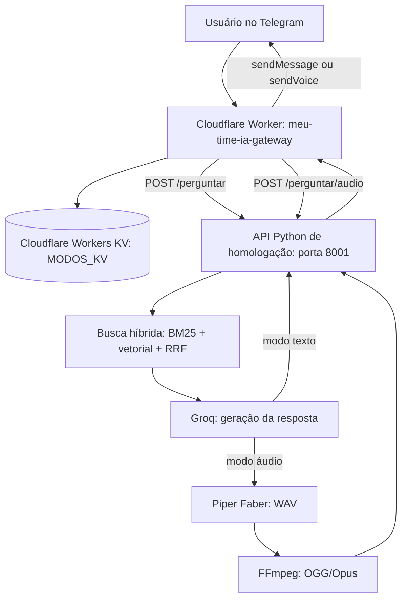

# Meu Time IA — Respostas em texto e áudio no Telegram

## Objetivo

Documentar a implementação e validação de respostas multimodais no **ambiente de homologação** do Meu Time IA. O usuário escolhe entre resposta escrita (`/texto`) e resposta falada (`/audio`). As perguntas, nesta etapa, são enviadas como texto; a recepção de perguntas por voz (STT) é uma evolução futura.

## Arquitetura



O Cloudflare Tunnel expõe a API de homologação em `https://api.silviolima.dev.br`. O Worker público recebe o webhook do bot de homologação, valida o token secreto e encaminha a pergunta para o backend. O Worker responde rapidamente ao webhook e continua o processamento com `ctx.waitUntil(...)`.

## Componentes e responsabilidades

| Componente | Responsabilidade |
|---|---|
| Telegram | Interface de perguntas e respostas; métodos `sendMessage` e `sendVoice` |
| Cloudflare Worker `meu-time-ia-gateway` | Autenticação do webhook, comandos, leitura/gravação da preferência, roteamento e envio ao Telegram |
| Workers KV `MODOS_KV` | Persistência da preferência por chat |
| Cloudflare Tunnel | Acesso HTTPS ao backend local de homologação |
| `api_homolog.py` | Validação da chave de backend e dos dados; rotas HTTP |
| `scripts/rag_core.py` | Recuperação híbrida, montagem do contexto e geração via Groq |
| `audio_service.py` | Síntese com Piper Faber, conversão FFmpeg e limpeza de temporários |

## Comandos e preferência

- `/start`: apresenta o bot e os comandos disponíveis.
- `/audio`: salva `audio` em `env.MODOS_KV.put(`modo:${chatId}`, "audio")` e confirma no Telegram.
- `/texto`: salva `texto` para o chat e confirma no Telegram.
- Perguntas comuns: consultam `env.MODOS_KV.get(`modo:${chatId}`)`; sem preferência válida, o padrão é `texto`.

A preferência é associada ao **ID do chat**, não a uma sessão de processo. KV apresenta consistência eventual; mudanças de modo podem levar algum tempo para se propagar entre regiões. Para uso mais rigoroso, considerar mecanismos de consistência mais forte ou tratamento explícito de comandos simultâneos.

## Contratos HTTP do backend

### `GET /health`

Retorna JSON indicando que o serviço de homologação está online.

### `POST /perguntar`

Requer o cabeçalho `X-Backend-API-Key` e JSON, por exemplo:

```json
{"pergunta":"Quem fundou o Flamengo?","modo":"texto"}
```

Retorna JSON com `resposta` e `fontes_recuperadas`.

### `POST /perguntar/audio`

Requer a mesma autenticação e um corpo JSON válido, por exemplo:

```json
{"pergunta":"Quem foi Zico na história do Flamengo?","modo":"audio"}
```

Executa o RAG no modo de resposta concisa, sintetiza a fala e retorna bytes com `Content-Type: audio/ogg`. O Worker envia o arquivo ao Telegram via `sendVoice`, usando `FormData` e um arquivo `resposta.ogg`.

A API valida tamanho do corpo, tipo e comprimento da pergunta, e modo solicitado. A resposta OGG é entregue com `Cache-Control: no-store`. O endpoint de áudio não retorna JSON em caso de sucesso.

## Geração do áudio

1. `perguntar_llm(pergunta, contexto, "audio")` produz uma resposta condensada para fala, visando cerca de 20–40 segundos.
2. `audio_service.gerar_audio_ogg(texto)` invoca o Piper com o modelo `modelos/piper/pt_BR-faber-medium/pt_BR-faber-medium.onnx`.
3. Piper gera WAV temporário.
4. FFmpeg converte para OGG com codec Opus (`libopus`).
5. Os arquivos temporários são removidos; a API devolve os bytes OGG.

O áudio é gerado **no notebook Ubuntu que hospeda a API**, e entregue ao usuário pelo Telegram. Não é necessário reproduzi-lo no dispositivo que executa o servidor.

## Segurança e separação de ambientes

- O Worker valida `X-Telegram-Bot-Api-Secret-Token` contra `WEBHOOK_SECRET`.
- A API exige `X-Backend-API-Key`, comparada com `hmac.compare_digest`.
- Tokens e chaves são armazenados em secrets/variáveis do ambiente, nunca no repositório.
- O backend de homologação atende em `127.0.0.1:8001`; a porta `8002` foi usada apenas para teste temporário.
- A implantação foi feita na homologação. O serviço de produção `meu-time-ia.service` não foi alterado.
- Antes da alteração, foi salvo um backup do JavaScript do Worker (`worker_backup.js`) e da API (`api_homolog.py.bak_audio`).

## Testes executados e resultados

| Teste | Resultado observado |
|---|---|
| Compilação de `api_homolog.py` (`py_compile`) | Sem erros |
| `POST /perguntar/audio` na porta 8002 | HTTP 200; `audio/ogg`; aproximadamente **30,49 s** |
| Reprodução do arquivo OGG no Windows, copiado do Ubuntu por SCP | Qualidade de áudio aprovada |
| Reinicialização de `meu-time-api-homolog.service` | Serviço `active` |
| `GET /health` na porta 8001 | JSON com `status: online` |
| Chamada sem chave a `/perguntar/audio` na porta 8001 | HTTP 401, conforme esperado |
| Comando `/audio` no Telegram | Confirmação recebida |
| Pergunta sobre Zico em modo áudio | Mensagem de voz recebida e reproduzida; usuário relatou resposta rápida |
| Comando `/texto` e pergunta subsequente | Resposta escrita recebida |

**Limitação da medição:** o teste de 30,49 s mede o tempo total da chamada HTTP, não o tempo isolado de busca, LLM, Piper ou FFmpeg. A percepção de rapidez no Telegram não constitui uma medição objetiva de latência.

## Operação e diagnóstico

Verificar o serviço de homologação:

```bash
systemctl is-active meu-time-api-homolog.service
curl -sS http://127.0.0.1:8001/health
```

Verificar a existência e proteção da rota de áudio sem divulgar a chave:

```bash
curl -sS -o /dev/null -w 'HTTP: %{http_code}\n' \
  -X POST http://127.0.0.1:8001/perguntar/audio
# Esperado: HTTP 401
```

Consultar logs, se necessário:

```bash
sudo journalctl -u meu-time-api-homolog.service -n 100 --no-pager
```

No Cloudflare, examinar os logs do Worker e verificar o binding `MODOS_KV`. Erros de resposta podem ocorrer no backend, na conversão de áudio, no túnel ou no envio `sendVoice` ao Telegram.

## Melhorias futuras

- Perguntas por mensagem de voz: Telegram → download do áudio → STT → RAG → resposta conforme modo selecionado.
- Instrumentação de latência por etapa (busca, LLM, Piper, FFmpeg e envio Telegram).
- Testes de concorrência, limites de duração/tamanho do áudio e tratamento de timeouts.
- Revisão da consistência do KV em trocas rápidas de modo.
- Documentação dos procedimentos de deploy e rollback do Worker.

## Arquivos e serviços envolvidos

```text
meu_time_ai_homolog/
├── api_homolog.py
├── api_homolog.py.bak_audio
├── audio_service.py
├── scripts/
│   └── rag_core.py
└── modelos/piper/pt_BR-faber-medium/
    ├── pt_BR-faber-medium.onnx
    └── pt_BR-faber-medium.onnx.json

Cloudflare Worker: meu-time-ia-gateway
Cloudflare KV namespace: MODOS_KV
Worker binding: MODOS_KV
API systemd: meu-time-api-homolog.service
Produção preservada: meu-time-ia.service
```

> **Status:** implementação e testes funcionais concluídos na homologação. Não confundir com implantação em produção.
