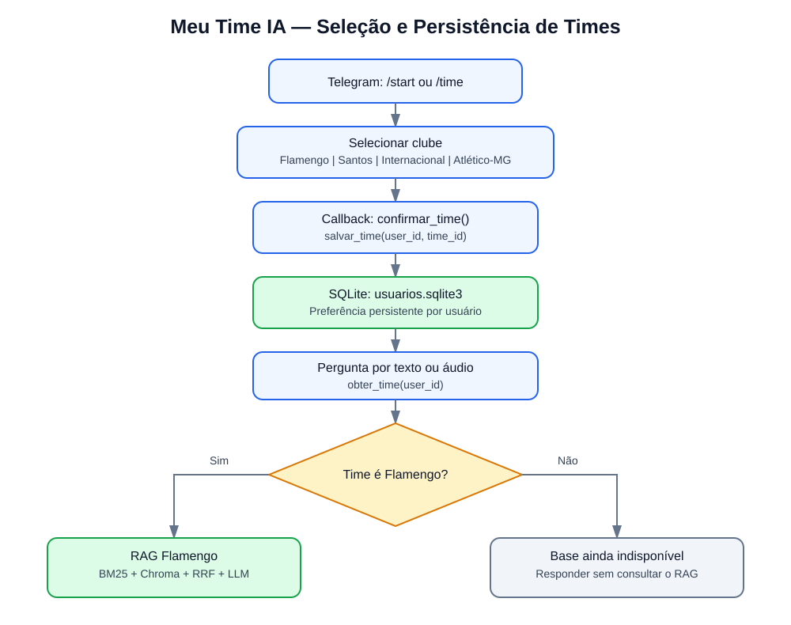

# Meu Time IA — Implementação da Seleção de Múltiplos Times

**Data:** 28/10/2026
**Branch:** `feature/multiplos-times`
**Status:** Seleção e persistência implementadas e testadas.

## 1. Objetivo

Evoluir o Meu Time IA de uma aplicação dedicada ao Flamengo para uma arquitetura capaz de atender quatro clubes:

- Flamengo
- Santos
- Internacional
- Atlético Mineiro

Nesta primeira etapa, foram implementadas a seleção do clube pelo Telegram, a persistência da preferência no SQLite e a proteção contra consultas a bases ainda indisponíveis.

**Importante:** somente o Flamengo possui uma base RAG operacional nesta versão.

## 2. Arquitetura e fluxo do processo



O processo funciona da seguinte maneira:

1. O usuário envia `/start` ou `/time`.
2. O Telegram apresenta quatro botões para seleção do clube.
3. O usuário seleciona seu time.
4. O `CallbackQueryHandler` executa a função `confirmar_time()`.
5. A função `salvar_time()` registra a preferência no SQLite.
6. O usuário envia uma pergunta em texto ou áudio.
7. O sistema recupera o `user_id` do Telegram.
8. A função `obter_time()` consulta a preferência armazenada.
9. O `time_id` é encaminhado para `processar_pergunta()`.
10. Se o clube for Flamengo, o RAG existente é executado.
11. Para os demais clubes, o sistema informa que a base ainda não está disponível, sem executar a recuperação RAG.

## 3. Arquivos envolvidos

| Arquivo | Responsabilidade |
|---|---|
| `scripts/09_telegram_pipeline.py` | Comandos, botões, callbacks e integração com o RAG |
| `scripts/preferencias_usuario.py` | Persistência das preferências no SQLite |
| `dados_processados/usuarios.sqlite3` | Banco de preferências dos usuários |
| `.gitignore` | Exclusão do banco SQLite do Git |
| `docs/imagens/fluxo_selecao_times.svg` | Diagrama visual da implementação |
| `docs/MEU_TIME_IA_MULTIPLOS_TIMES.md` | Documentação técnica |

## 4. Persistência SQLite

O módulo `preferencias_usuario.py` utiliza a biblioteca padrão `sqlite3` do Python.

A tabela possui dois campos:

- `user_id`: identificador único da conta do Telegram, utilizado como chave primária.
- `time_id`: identificador do clube escolhido.

A função `inicializar_banco()` cria a tabela quando necessário.

A função `salvar_time(user_id, time_id)` insere ou atualiza a preferência. O SQL utiliza `ON CONFLICT(user_id) DO UPDATE`, evitando registros duplicados.

A função `obter_time(user_id)` recupera o clube selecionado. Para usuários sem preferência cadastrada, retorna `flamengo`, mantendo a compatibilidade com a versão anterior.

O banco SQLite é independente do banco interno do ChromaDB e não é versionado no Git.

## 5. Implementação no Telegram

### 5.1 Seleção do clube

A função `selecionar_time()` apresenta os quatro clubes por meio de `InlineKeyboardButton` e `InlineKeyboardMarkup`.

Cada botão possui um identificador de callback, como `time:santos`.

### 5.2 Confirmação da escolha

A função `confirmar_time()`:

1. Recebe o clique do usuário.
2. Identifica e valida o clube selecionado.
3. Recupera o identificador do usuário.
4. Executa `salvar_time()`.
5. Confirma a seleção no Telegram.

O tratamento é registrado por `CallbackQueryHandler`, utilizando o padrão `^time:`.

### 5.3 Comandos disponíveis

| Comando | Finalidade |
|---|---|
| `/start` | Apresentar mensagem inicial e seleção de clube |
| `/time` | Selecionar ou alterar o clube |
| `/texto` | Configurar respostas em texto |
| `/audio` | Configurar respostas em áudio |
| `/ajuda` | Mostrar orientações e comandos |

## 6. Integração com o RAG

A função `processar_pergunta()` recebeu um novo parâmetro opcional:

`time_id: str = "flamengo"`

Esse valor padrão preserva a compatibilidade com as chamadas anteriores.

Os fluxos de texto e áudio consultam a preferência armazenada no SQLite e encaminham o clube selecionado ao processamento.

Para o Flamengo, permanece o pipeline existente:

- Recuperação lexical com BM25.
- Recuperação vetorial com ChromaDB.
- Fusão de resultados com RRF.
- Montagem do contexto.
- Geração da resposta por LLM via API.
- Envio da resposta ao Telegram.

Para Santos, Internacional e Atlético Mineiro, o processamento retorna uma mensagem de indisponibilidade da base, sem consultar o RAG do Flamengo.

## 7. Testes realizados

| Teste | Resultado |
|---|---|
| Verificação de sintaxe Python | Aprovado |
| Seleção do Santos | Funcionou |
| Pergunta com Santos selecionado | Base indisponível informada |
| Alteração para Flamengo | Funcionou |
| Pergunta sobre Santos com Flamengo selecionado | Informação não encontrada na base |
| Parada e inicialização do serviço | Preferência preservada |
| Reinicialização do serviço | Preferência preservada |

Os testes confirmaram o funcionamento da seleção, da recuperação da preferência e da persistência entre reinicializações.

## 8. Decisões técnicas

A implementação adotou as seguintes diretrizes:

- Utilizar SQLite em vez de introduzir um serviço adicional de banco de dados.
- Manter um único modelo de embeddings compartilhado.
- Preservar o pipeline existente do Flamengo.
- Não carregar modelos adicionais desnecessariamente.
- Manter os benchmarks como avaliações offline.
- Evitar alterações incompatíveis com as funções existentes.
- Considerar as limitações de memória do notebook utilizado como servidor.

## 9. Limitações atuais

Ainda não estão implementados:

- Bases documentais dos outros três clubes.
- Índices BM25 e coleções vetoriais independentes por clube.
- Roteamento da recuperação híbrida por `time_id`.
- Detecção explícita de perguntas sobre um clube diferente do selecionado.
- Orquestração com LangGraph.
- Benchmark multiclubes.

## 10. Próximas etapas

1. Organizar o corpus documental dos quatro clubes.
2. Definir a estrutura de armazenamento por clube.
3. Implementar índices independentes, compartilhando o modelo de embeddings.
4. Adaptar a busca híbrida para utilizar `time_id`.
5. Preservar a compatibilidade com o benchmark do Flamengo.
6. Implementar a detecção de conflitos entre a pergunta e o clube selecionado.
7. Avaliar a integração do LangGraph.
8. Executar benchmarks offline e documentar os resultados.

## 11. Conclusão

A primeira etapa da evolução para múltiplos times foi implementada e validada funcionalmente.

A seleção de clubes, a persistência SQLite e a proteção contra consultas a bases indisponíveis estão operacionais.

A próxima etapa será implementar o RAG multiclubes, com bases independentes e recuperação direcionada ao clube selecionado.

## 12. Implementação e validação do BM25 multiclubes

### 12.1 Objetivo

Adaptar a recuperação lexical BM25 para aceitar um identificador de clube (`time_id`), preservando o comportamento original do Flamengo e preparando o sistema para índices independentes de Santos, Internacional e Atlético Mineiro.

Esta etapa modifica `scripts/rag_core.py`, sem alterar o corpus ou os índices existentes do Flamengo.

### 12.2 Seleção dos recursos BM25

Foi criada a função `obter_recursos_bm25(time_id="flamengo")`.

Seu funcionamento é:

1. Para `flamengo`, reutiliza o índice BM25 e os documentos já carregados na memória.
2. Para os outros três clubes cadastrados, procura os arquivos em `dados_processados/times/<time_id>/bm25/`.
3. Para um identificador desconhecido, lança `ValueError`.
4. Se os arquivos de índice ou documentos ainda não existem, lança `FileNotFoundError`.
5. Quando os arquivos existem, carrega o índice e os documentos correspondentes.

A função `busca_bm25()` passou a aceitar um parâmetro opcional `time_id`, mantendo `flamengo` como valor padrão.

Essa escolha preserva as chamadas anteriores, incluindo aquelas utilizadas no benchmark original. Os recursos de outros clubes são carregados sob demanda, sem substituir o índice global do Flamengo.

### 12.3 Verificação estática

Comando executado:

```bash
python3 -m py_compile scripts/rag_core.py && git diff --check && git diff --stat
```

O que cada parte verifica:

- `python3 -m py_compile`: compila o arquivo Python para verificar erros de sintaxe, sem executar o pipeline RAG.
- `git diff --check`: identifica problemas de whitespace nas alterações versionadas.
- `git diff --stat`: apresenta um resumo dos arquivos e linhas modificados.

Resultado observado:

```text
scripts/rag_core.py | 46 +++++++++++++++++++++++++++++++++++++++++++---
1 file changed, 43 insertions(+), 3 deletions(-)
```

**Resultado: aprovado.** Nenhum erro de sintaxe ou whitespace foi identificado.

### 12.4 Preparação do ambiente de execução

Na primeira tentativa do teste funcional, o Python do sistema apresentou:

```text
ModuleNotFoundError: No module named 'chromadb'
```

A causa foi a execução fora do ambiente virtual do projeto. Não foi necessário instalar novamente a biblioteca.

O ambiente virtual existente foi identificado e ativado com:

```bash
source .venv/bin/activate
```

Após a ativação, o teste foi executado com `python`, utilizando as dependências do projeto.

### 12.5 Teste funcional de compatibilidade e isolamento

Código executado a partir da raiz do repositório, com `.venv` ativado:

```bash
python - <<'PY'
import sys
sys.path.insert(0, "scripts")

from rag_core import busca_bm25

pergunta = "Quais são os títulos do Flamengo?"

antigo = busca_bm25(pergunta)
novo = busca_bm25(pergunta, time_id="flamengo")

assert antigo == novo, "ERRO: resultados diferentes para o Flamengo"

print("[OK] Compatibilidade com Flamengo preservada.")
print("Resultados:", len(novo))
print("Chunks:", [r["chunk_id"] for r in novo])

try:
    busca_bm25(pergunta, time_id="santos")
except FileNotFoundError:
    print("[OK] Santos sem índice: consulta bloqueada corretamente.")
else:
    raise AssertionError("Santos não deveria utilizar um índice inexistente.")
PY
```

Explicação das verificações:

- A importação de `rag_core` carrega os recursos necessários do pipeline, incluindo BM25, ChromaDB e o modelo de embeddings.
- `antigo` representa a chamada original, sem especificar o clube.
- `novo` representa a chamada com `time_id="flamengo"`.
- `assert antigo == novo` exige igualdade completa dos resultados retornados pelas duas chamadas para a pergunta testada.
- A consulta ao Santos verifica se o sistema recusa corretamente a utilização de um índice ainda inexistente, em vez de recuperar documentos do Flamengo.
- A captura de `FileNotFoundError` confirma que essa indisponibilidade é tratada como uma condição esperada no teste.

### 12.6 Evidências e resultados

Saída observada:

```text
Carregando BM25...
[OK] BM25 carregado.
Carregando ChromaDB...
[OK] Chroma carregado (72 registros).
Carregando modelo de embeddings...
[OK] Modelo carregado.
[OK] Compatibilidade com Flamengo preservada.
Resultados: 5
Chunks: [11, 1, 55, 70, 48]
[OK] Santos sem índice: consulta bloqueada corretamente.
```

A linha de progresso do carregamento dos pesos do modelo foi omitida da transcrição acima por não alterar o resultado do teste.

| Verificação | Resultado |
|---|---|
| Sintaxe de `rag_core.py` | Aprovado |
| Whitespace das alterações | Aprovado |
| Carregamento dos recursos do RAG | Aprovado |
| Igualdade entre chamadas BM25 antiga e nova | Aprovado |
| Quantidade de resultados BM25 | 5 |
| IDs dos chunks retornados | 11, 1, 55, 70, 48 |
| Consulta ao Santos sem índice | `FileNotFoundError`, conforme esperado |

### 12.7 Alcance e limitações da validação

O teste confirma a compatibilidade da busca BM25 do Flamengo para uma pergunta específica e o bloqueio de uma consulta a um clube sem índice.

Ele ainda **não comprova**:

- Equivalência para todas as perguntas do benchmark original.
- Funcionamento de índices BM25 já construídos para os outros clubes.
- Roteamento da busca vetorial por coleção ChromaDB.
- Roteamento da recuperação híbrida BM25 + ChromaDB + RRF.
- Qualidade da recuperação medida por Recall@K, Precision@K e outras métricas.
- Desempenho e consumo de memória com múltiplos clubes.

A próxima etapa é adaptar a busca vetorial para selecionar a coleção correspondente ao `time_id`, mantendo um único modelo de embeddings compartilhado.

**Estado ao final desta etapa:** adaptação do BM25 implementada e teste funcional pontual aprovado; integração vetorial e benchmark multiclubes pendentes.

### 12.9 Execução dos testes automatizados

Os testes funcionais foram salvos em `tests/test_roteamento_times.py`, utilizando a biblioteca padrão `unittest` do Python.

Com o ambiente virtual `.venv` ativado, executar na raiz do repositório:

```bash
python -m unittest discover -s tests -p 'test_*.py' -v
```

O comando identifica os arquivos `test_*.py` no diretório `tests`, executa os métodos de teste e apresenta os resultados detalhados (`-v`).

**Resultado observado em 28/10/2026:**

| Teste | Resultado |
|---|---|
| `test_bm25_compatibilidade_flamengo` | Aprovado |
| `test_bm25_santos_sem_indice` | Aprovado |
| `test_clube_invalido` | Aprovado |
| `test_vetorial_compatibilidade_flamengo` | Aprovado |
| `test_vetorial_santos_sem_colecao` | Aprovado |

```text
Ran 5 tests in 41.414s

OK
```

Os cinco testes passaram sem falhas. O modelo de embeddings foi carregado uma única vez durante a execução.

Esses testes verificam compatibilidade e tratamento de recursos indisponíveis. Não avaliam Recall@K, Precision@K ou qualidade das respostas geradas pela LLM.

Os testes que esperam ausência de índices ou coleções do Santos deverão ser atualizados quando esses recursos forem implementados.

### 12.10 Validação da recuperação híbrida multiclubes

A função `busca_hibrida()` foi adaptada para receber o parâmetro opcional `time_id`, com valor padrão `"flamengo"`.

Esse identificador é encaminhado às funções `busca_bm25()` e `busca_vetorial()`. O algoritmo Reciprocal Rank Fusion (RRF) e seus parâmetros permanecem inalterados.

Foi acrescentado ao arquivo `tests/test_roteamento_times.py` o teste automatizado `test_hibrida_compatibilidade_flamengo`.

O teste compara:

```python
antigo = busca_hibrida(pergunta)
novo = busca_hibrida(pergunta, time_id="flamengo")

assert antigo == novo
```

O objetivo é verificar se a introdução do parâmetro `time_id` preserva os resultados da recuperação híbrida para a pergunta testada.

**Comando de execução:**

```bash
python -m unittest discover -s tests -p 'test_*.py' -v
```

**Resultado observado em 28/10/2026:**

```text
Ran 6 tests in 121.416s

OK
```

Todos os seis testes foram aprovados.

Esta validação confirma a compatibilidade funcional nas condições testadas, mas ainda não verifica a recuperação de documentos de outros clubes, pois seus índices não foram construídos.

O benchmark original de 15 perguntas e respostas sobre o Flamengo permanece independente desta etapa.

### Testes de integração Telegram → RAG

**Script:** `tests/test_integracao_telegram_rag.py`

**Objetivo:** validar o encaminhamento do `time_id` e o bloqueio de consultas a clubes sem base de conhecimento disponível.

**Estratégia:** testes automatizados com `unittest` e `unittest.mock`. A função `processar_pergunta()` é extraída com `ast`, evitando importar o módulo completo do Telegram e carregar Whisper, embeddings ou acessar a API da Groq.

**Comando de execução:**

```bash
python -m unittest discover -s tests -p 'test_integracao_telegram_rag.py' -v

```

**Resultados:** 2 testes aprovados em 0,022 s.

- Flamengo: encaminhamento do time_id confirmado.
- Santos: bloqueio de consulta sem executar RAG ou LLM confirmado.

**Limitação:** testes com dependências simuladas; não substituem testes reais com Telegram.
